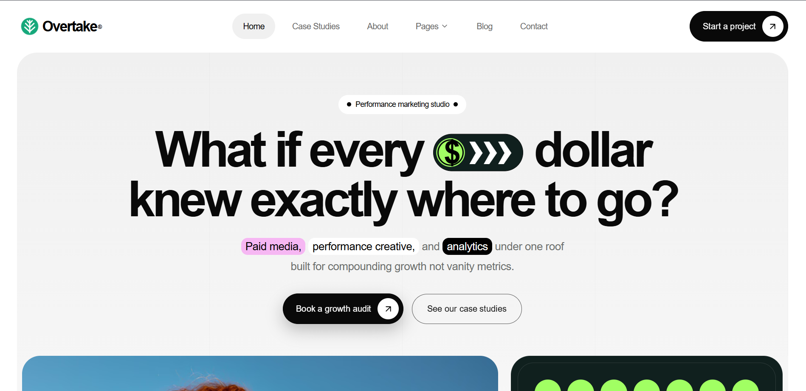

<!-- Replace this image path with your website screenshot or banner -->

Overtake Growth
Performance marketing that compounds growth.
Live Website

About
Overtake Growth is a performance marketing agency focused on helping brands grow through strategic media buying, performance creative, and data-driven analytics.
The website presents the agency's services, approach, insights, and contact options in a responsive, modern interface.
Features
- Responsive landing page and navigation
- Animated hero section and reusable call-to-action buttons
- Brand and services marquees
- Metrics and growth-process sections
- Services and case-study presentation
- Insights/blog section
- Contact form with custom dropdown
- Scroll-based animations and interactive elements
Tech Stack
- React
- Vite
- Tailwind CSS
- Motion / Framer Motion
- Lucide React
Getting Started
Prerequisites
- Node.js
- npm
Installation
git clone <your-repository-url>
cd <your-project-folder>
npm install
npm run dev
Vite will print the local development URL in your terminal.
Build for Production
npm run build
npm run preview
Project Structure
src/
├── components/
├── pages/
├── data/
└── ...
public/
└── assets/
Links
- Live website: https://overtake-growth.onrender.com/
- Repository: Add your GitHub repository URL here

Built with care by Overtake Growth Inc.

